# AI Customer Support Automation

A multi-agent support desk for **ShopNest**, a made-up online store. Four AutoGen agents powered by Claude read a customer complaint, look up the answer in the company's own policy documents, write a grounded reply in the customer's own language, and log every ticket. Hard cases go to a human support person, who approves, edits or rejects the reply before it is sent.

Built with **AutoGen (agentchat 0.7)**, **Anthropic Claude**, **ChromaDB** and **Streamlit**.

Version 2.0 adds a login page, a **customer portal** in an online-store style (My Orders with filters, search and order status, where customers raise a complaint from an order) and a separate **admin panel** for the support team.

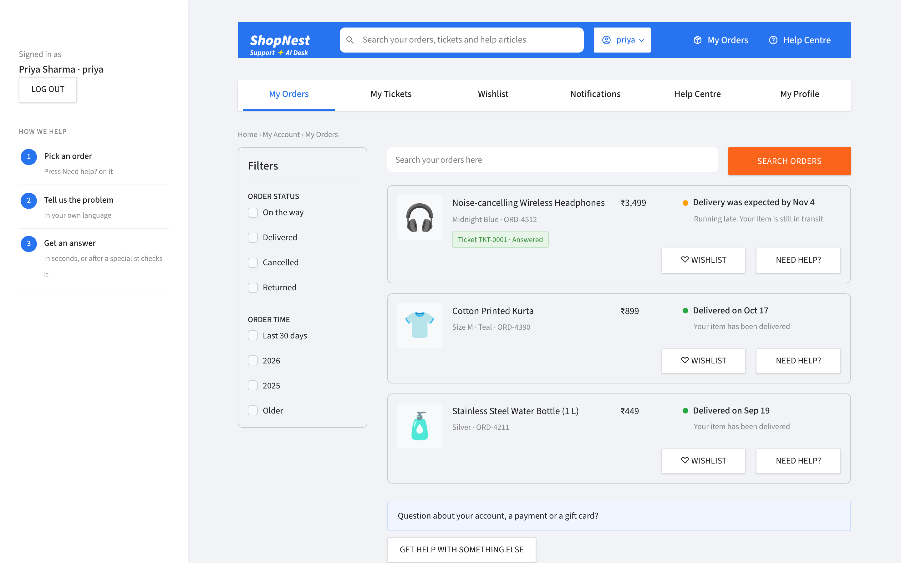

## The two panels

| | Customer portal | Admin panel |
|---|---|---|
| Who | Customers (demo: `priya`, `arjun`, `rahul` ... password `Welcome@123`) | Support team (`admin1`, password `Admin@123`) |
| Pages | **Account menu** (click your username in the blue header, like an online store): My Profile, Orders, Wishlist, Notifications, Logout<br>**My Orders**: filters for order status and order time, order search, each order's status, and **Need help?** to raise a complaint about that order<br>**Need help? / Submit**: a live timeline shows each agent's step as it happens (request understood, policies checked with the matching passages, reply written, ticket saved), then the reply with the policy documents it used<br>**My Tickets**: each ticket's reply with category, language and source badges, "How we handled this ticket", a ticket log table with CSV download, and **Reply to this ticket** for follow-ups<br>**Help Centre**: browse and search the four policy documents the AI answers from<br>**Wishlist**: saved products; add any order with ♡ Wishlist, remove with one click<br>**Notifications**: ticket replies, specialist reviews and order updates, each with a View link<br>**My Profile**: personal information, activity counts and change password<br>**My Account**: profile and change password | **Dashboard**: KPIs and charts<br>**Ticket status**: every ticket as a colour-coded card (status, urgency, mood, language, customer, order, escalation reason and the reply), with filters, search and a table view<br>**Approvals**: approve, edit or reject escalated replies<br>**Knowledge base**: every section with topic and document filters, and a search tester comparing vector, keyword and hybrid results<br>**Users**: create users (default password `Welcome@123`) and reset passwords<br>**Ticket log**: full log with CSV / Excel download<br>**Agent console**: run any complaint and see each agent's output |

When a customer raises a complaint, the order's details (product, status, delivery dates) go to the agents with it, so the reply can be specific. Resolved tickets are answered straight away. Escalated ones show "Under review" until the support team approves the reply, and then the customer sees it in My Tickets.

Accounts are stored in `data/users.json` (created on first run, not committed) with salted PBKDF2 password hashes. Sample orders are in `data/orders.json`, with dates relative to today.

## How it works

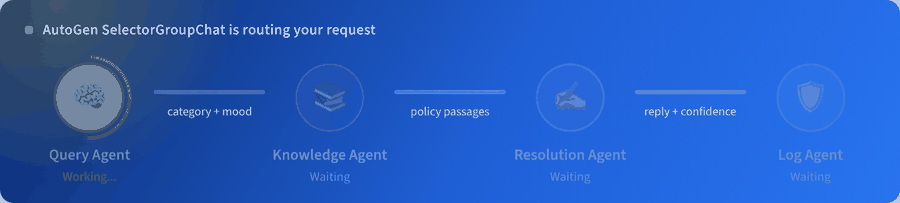

While a ticket runs, the portal shows the four agents as an animated pipeline: the active agent pulses, data packets travel along each link (category and mood, policy passages, reply and confidence), and each agent ticks green as it finishes. The admin **Dashboard** is an infographic page: headline ring gauges (automation rate, grounded answers, average urgency), the ticket journey from received to human review, category tiles with their AI resolution rate, ticket volume, urgency mix, languages, customer mood and escalation reasons.

```
Customer complaint (Streamlit form)
        │
        ▼
┌──────────────────────┐   CATEGORY / URGENCY / SENTIMENT / SUMMARY
│ Customer Query Agent │──────────────────────────────────────────┐
└──────────────────────┘                                          │
        ▼                                                         │
┌──────────────────────┐   search_kb(query) ──► ChromaDB + BM25   │
│ Knowledge Base Agent │   passages + source file names           │
└──────────────────────┘                                          │
        ▼                                                         │
┌──────────────────────┐   REPLY / USED_SOURCES / CONFIDENCE      │
│   Resolution Agent   │   (only facts from the passages)         │
└──────────────────────┘                                          │
        ▼                                                         ▼
┌──────────────────────┐   log_ticket(...) ──► logs/tickets.csv
│      Log Agent       │   escalation rule ──► Resolved / Escalated
└──────────────────────┘   replies "LOGGED TKT-0007" ──► team stops
        │
        ▼  (escalated tickets only)
┌──────────────────────┐   Approvals tab: approve / edit / reject
│ Support reviewer     │   UserProxyAgent ──► review_status, final_response
│ (human)              │
└──────────────────────┘
```

| Agent | Job | Output |
|---|---|---|
| Customer Query Agent | Understands the complaint | Category, urgency (Low/Medium/High), sentiment, language, one-line summary |
| Knowledge Base Agent | Calls the `search_kb` tool | Matching passages with their source file |
| Resolution Agent | Writes the customer reply from the passages only, in the customer's language | Reply, sources used, confidence |
| Log Agent | Calls the `log_ticket` tool | One CSV row, status and escalation reason |
| Support reviewer (human) | A `UserProxyAgent` for the support person | Approved, edited or rejected reply |

The agents run in a `SelectorGroupChat`: after each message the model reads the conversation and the agents' descriptions and picks who speaks next (normally Query → Knowledge → Resolution → Log). A `candidate_func` offers only agents that haven't spoken yet, so each does its job once and the run can't loop. A `TextMentionTermination("LOGGED")` on the Log Agent ends the run, with a `MaxMessageTermination(8)` as a safety net.

### Human in the loop

Escalated tickets are logged as **Pending approval**. In the app's **Approvals** tab, a support person reads the complaint, the reason it was escalated and the draft reply, then approves it, edits it, or rejects it with a note. The decision goes through AutoGen's `UserProxyAgent` (`agents/review_agent.py`) and is saved in the ticket log (`review_status`, `reviewer`, `final_response`, `reviewed_at`). Running `python team.py "..."` asks for the same decision in the terminal.

### Customer language

The Query Agent detects the complaint's language, including Indian languages such as Tamil, Malayalam, Telugu and Hindi (and Tanglish-style mixes). The Knowledge Base Agent still searches in English, and the Resolution Agent writes the reply in the customer's language. The language is shown on the result and saved in the log.

### Knowledge base (RAG)

`knowledge_base/` holds four policy documents: shipping, refunds, account and login, and a product FAQ. Each file is split into sections by its `##` headings, embedded with ChromaDB's built-in local model (all-MiniLM-L6-v2, so no extra API key is needed) and stored in `chroma_db/`. The index rebuilds itself whenever a document changes.

**Hybrid search.** Every query runs two searches: ChromaDB vector search (meaning) and BM25 keyword search (exact words and figures such as "15 minutes" or "₹10,000"; numbers are kept whole and words are lightly stemmed). The two rankings are combined with Reciprocal Rank Fusion. A section counts as relevant if it is close in vector space or a strong keyword match, so unrelated questions still return nothing. If ChromaDB is unavailable, BM25 keeps working on its own.

**Section metadata.** Each section is stored with its document and a topic (Shipping, Refund, Account, Product, Billing). The Query Agent's category gives sections on that topic a small boost, and the admin **Knowledge base** tab filters by topic and document.

### Follow-ups

A customer can reply to any ticket in My Tickets. Every follow-up, whatever its length, is rewritten by Claude into one standalone request that keeps the order ID, product and what was already promised (`agents/followup.py`). The rewritten request goes through the normal agent pipeline as a new ticket linked to the earlier one (`parent_ticket` in the log), so retrieval sees the full context instead of just "it still hasn't come".

### Escalation rule

A ticket is **Escalated** to human support when any of these is true; otherwise it is **Resolved**:

- urgency is High
- the customer is Angry or Very Angry
- no matching document was used for the reply
- the Resolution Agent's confidence is Low
- the complaint mentions legal action, fraud or a payment dispute

The rule lives in plain Python (`decide_escalation` in `agents/log_agent.py`) so it is predictable and easy to test.

## Project structure

```
├── app.py                     # Streamlit entry point: login, then the customer portal or the admin panel
├── auth.py                    # user accounts, hashed passwords, default password
├── orders.py                  # sample orders for the customer portal
├── wishlist.py                # customer wishlists (data/wishlists.json, created on first use)
├── ui/
│   ├── theme.py               # store look: colours, stylesheet, blue top bar
│   ├── login.py               # login page
│   ├── customer.py            # My Orders, My Tickets, My Account
│   ├── admin.py               # ticket status, approvals, log, dashboard, users, agent console
│   └── common.py              # shared pieces (running the agents, ticket cards)
├── data/orders.json           # sample orders (users.json is created on first run)
├── team.py                    # wires the four agents into one AutoGen team
├── test_cases.py              # runs the test complaints and checks the status
├── evaluate.py                # retrieval, faithfulness and follow-up evaluation, saved to CSV
├── evaluation/
│   ├── ground_truth.json      # 29 questions and 6 follow-ups with their correct sections and key facts
│   └── results/               # CSV output of evaluate.py
├── agents/
│   ├── model_client.py        # shared Claude model client
│   ├── query_agent.py         # Customer Query Agent
│   ├── knowledge_agent.py     # Knowledge Base Agent + search_kb tool (ChromaDB + BM25 hybrid)
│   ├── followup.py            # rewrites follow-ups into standalone requests
│   ├── resolution_agent.py    # Resolution Agent
│   ├── log_agent.py           # Log Agent + log_ticket tool + escalation rule
│   └── review_agent.py        # human approval through UserProxyAgent
├── knowledge_base/            # company documents
├── logs/tickets.csv           # created automatically
├── screenshots/
├── .env.example
├── requirements.txt
└── README.md
```

## Setup

You need Python 3.10 or newer and an Anthropic API key.

```bash
git clone https://github.com/iamsuresharchitect/AI-Customer-Support-Automation.git
cd AI-Customer-Support-Automation
python -m venv .venv
.venv\Scripts\activate          # Windows
# source .venv/bin/activate     # macOS / Linux
pip install -r requirements.txt
copy .env.example .env          # cp on macOS / Linux
```

Open `.env` and set `ANTHROPIC_API_KEY`. `ANTHROPIC_MODEL` is optional and defaults to `claude-opus-5-5`.

## Run

```bash
streamlit run app.py
```

The first run downloads the 80 MB embedding model once.

To run all test complaints from the terminal:

```bash
python test_cases.py        # all cases
python test_cases.py 5      # just case 5
```

## Test results

| # | Complaint | Result |
|---|---|---|
| 1 | Where is my order? It was supposed to arrive yesterday. | Shipping · shipping_policy.md · **Resolved** |
| 2 | I want to return the shoes I bought last week. How do I get a refund? | Refund · refund_policy.md · **Resolved** |
| 3 | I forgot my password and can't log in. | Account · account_and_login.md · **Resolved** |
| 4 | The blender I received is broken. Can I get a replacement? | Product · refund_policy.md, product_faq.md · **Resolved** |
| 5 | You charged my card three times! Fix this now or I'm contacting my bank and a lawyer. | Billing · High · Very Angry · **Escalated** (high urgency, angry, legal threat, payment dispute) |
| 6 | Do you sell gift cards for a company of 500 employees with custom branding? | Not covered by the docs · honest reply · **Escalated** (low confidence) |
| 7 *(own)* | Can I change the delivery address? I just placed the order an hour ago. | Shipping · shipping_policy.md · **Resolved** |
| 8 *(own)* | Someone logged into my account and placed orders I never made. This is fraud! | Account · High · Angry · **Escalated** (high urgency, angry, possible fraud) |
| 9 *(own)* | मेरा ऑर्डर अभी तक नहीं आया। यह कल आना था। (Hindi: my order hasn't arrived) | Shipping · Hindi · reply in Hindi · expected **Resolved** |
| 10 *(own)* | நான் கடந்த வாரம் வாங்கிய காலணிகளைத் திருப்பி அனுப்ப வேண்டும். பணத்தை எப்படித் திரும்பப் பெறுவது? (Tamil: return shoes, get a refund) | Refund · Tamil · reply in Tamil · expected **Resolved** |

Cases 1 to 8 matched the expected status in the live run. Cases 9 and 10 were added with the language feature.

## Screenshots

| Login | Customer: My Orders |
|---|---|
| 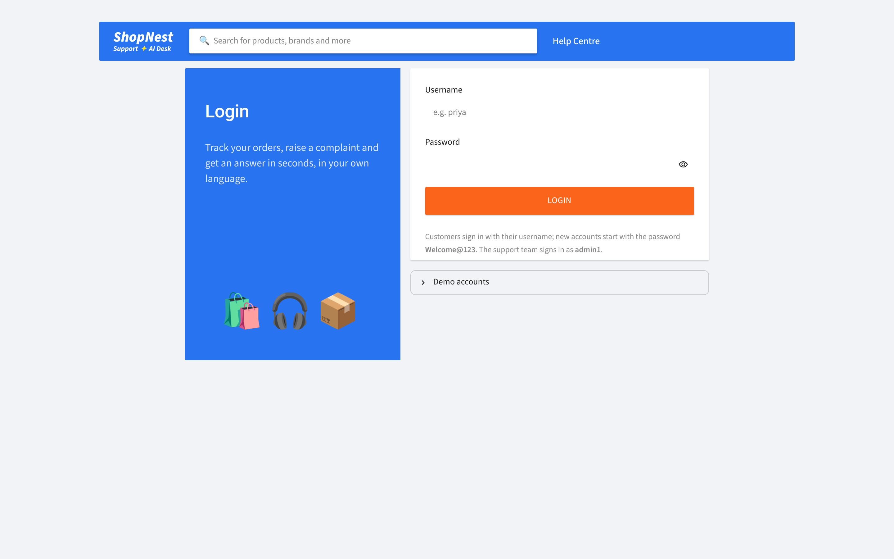 |  |

| Customer: raise a complaint | Customer: My Tickets |
|---|---|
| 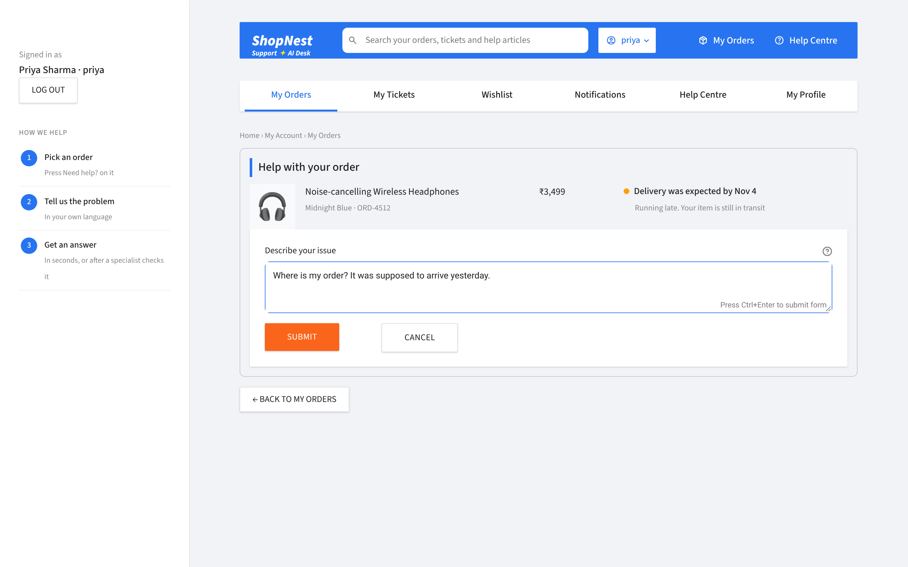 | 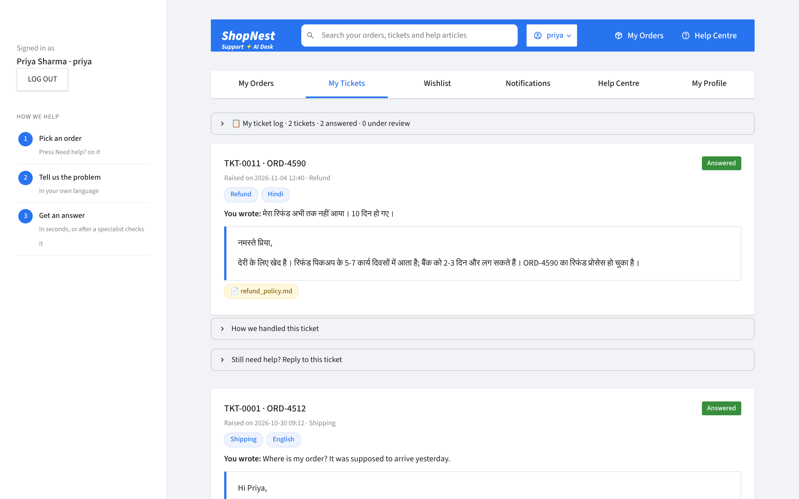 |

| Admin: ticket status | Admin: users |
|---|---|
| 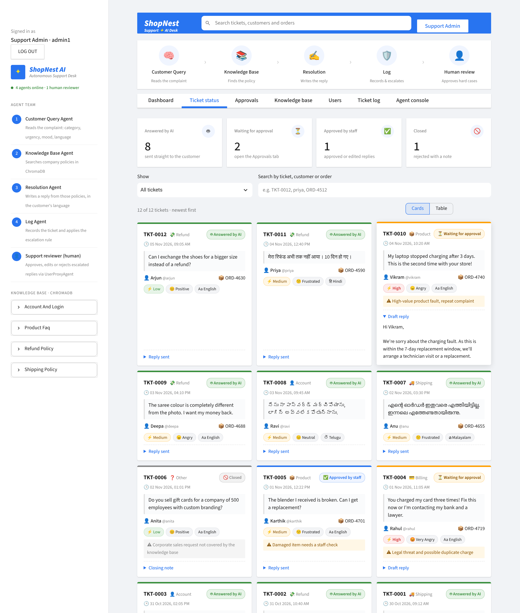 | 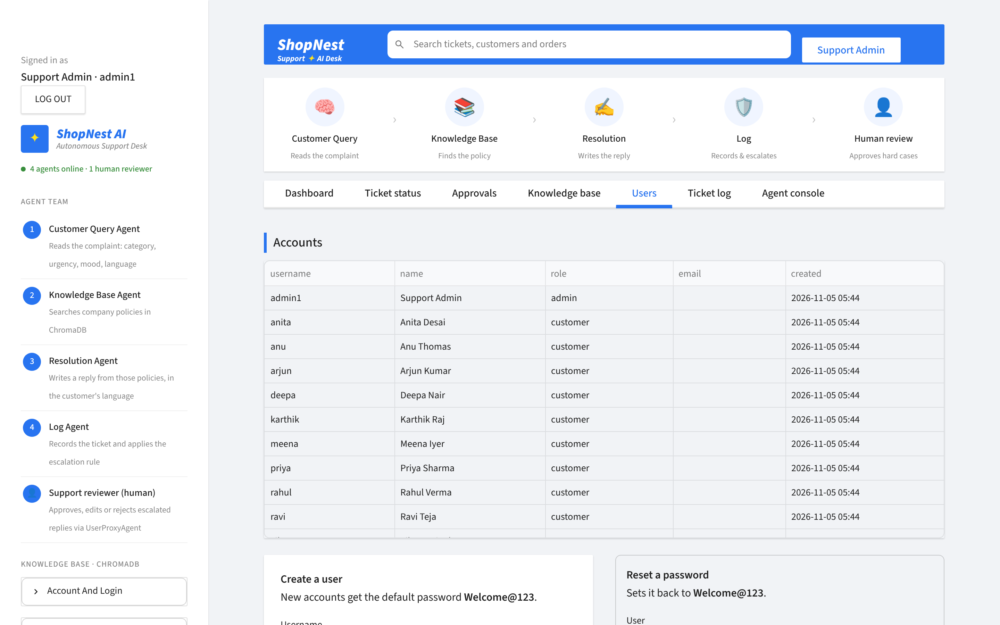 |

| Resolved ticket | Escalated ticket |
|---|---|
| 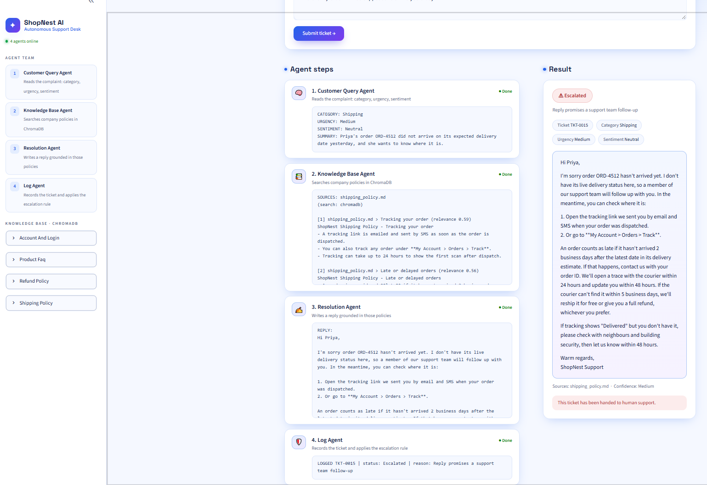 | 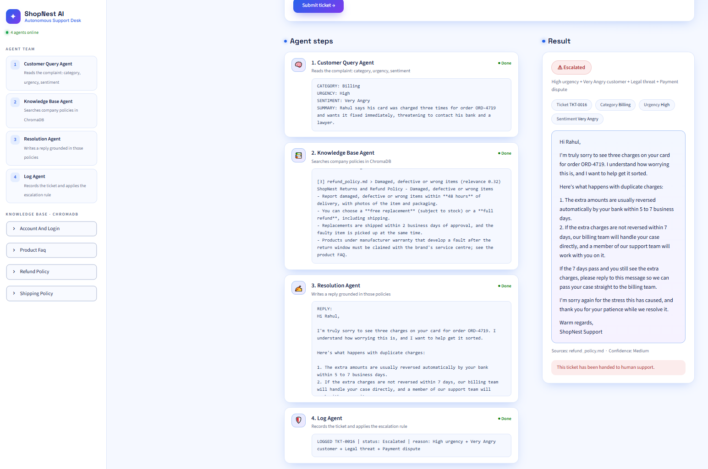 |

| Own test case: change address | Own test case: account fraud |
|---|---|
| 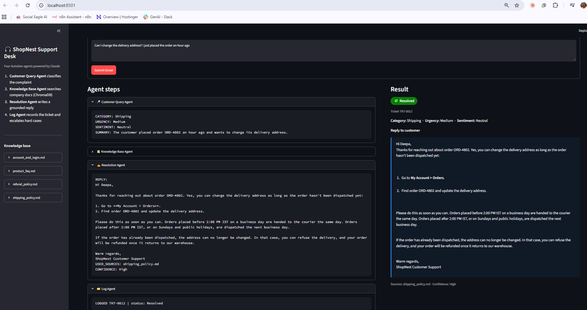 | 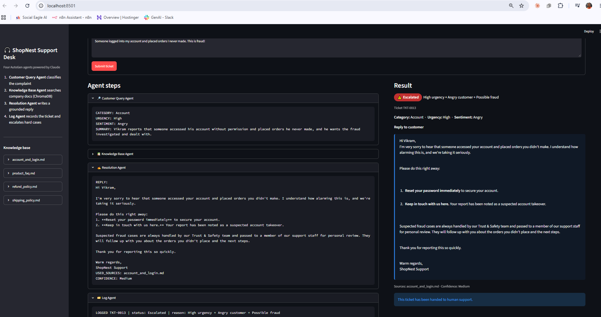 |

| Ticket log | Dashboard |
|---|---|
| 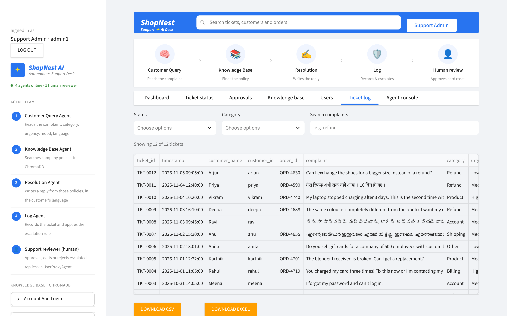 | 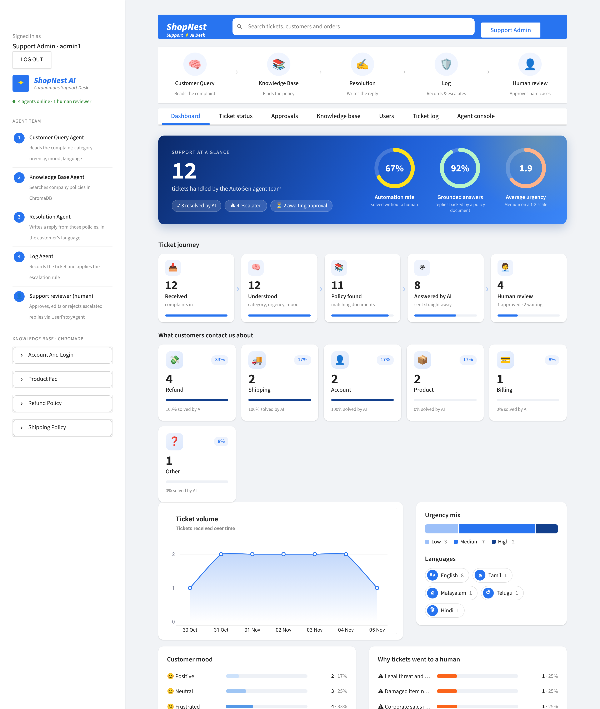 |

| Approvals (human in the loop) | Reply in the customer's language |
|---|---|
| 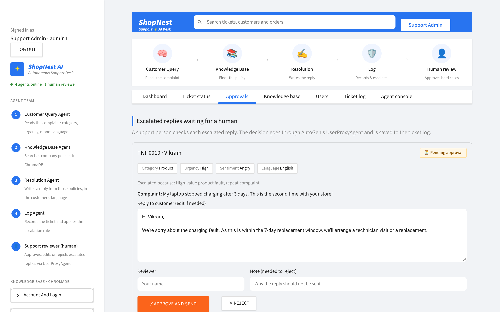 | 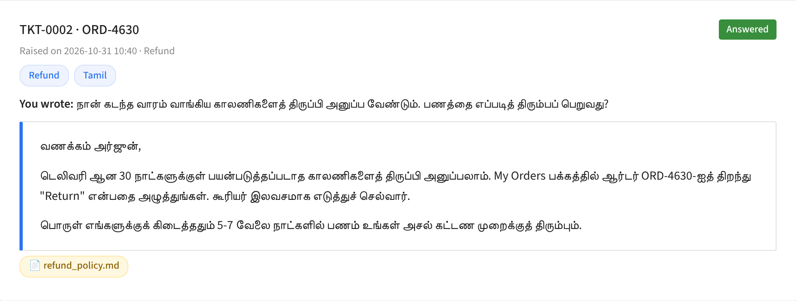 |

## Evaluation

`evaluate.py` scores the system against `evaluation/ground_truth.json`: 29 customer questions, each with the knowledge-base section(s) that answer it and the key fact the reply must contain, plus 6 follow-up conversations.

```bash
python evaluate.py              # retrieval only, no API key needed
python evaluate.py --answers    # + answer faithfulness (uses Claude)
python evaluate.py --followups  # + raw vs rewritten follow-ups (uses Claude)
python evaluate.py --all        # everything
```

| Part | What it measures |
|---|---|
| Retrieval | **hit@1**, **hit@3** and **MRR** for vector-only, BM25-only and hybrid search |
| Answers | **fact recall** (does the reply contain the expected fact) and **faithfulness** (supported claims ÷ all claims, judged by Claude against the retrieved passages) |
| Follow-ups | hit@3 when searching with the raw follow-up vs the Claude-rewritten one |

Each run writes `retrieval_`, `answers_`, `followups_` and `summary_<timestamp>.csv` to `evaluation/results/`.

Retrieval results (29 questions):

| Search | hit@1 | hit@3 | MRR |
|---|---|---|---|
| Vector only (ChromaDB) | 0.862 | 0.966 | 0.914 |
| Keyword only (BM25) | 0.897 | 0.931 | 0.914 |
| **Hybrid (RRF)** | **0.931** | **0.966** | **0.948** |

Answers and follow-ups (live run with Claude, 29 questions and 6 follow-ups):

| Metric | Result |
|---|---|
| Fact recall (reply contains the expected fact) | 0.931 |
| Faithfulness (supported claims ÷ all claims) | 0.942 |
| Follow-up hit@3, raw follow-up text | 0.667 |
| Follow-up hit@3, Claude-rewritten request | **1.000** |

## Bonus features

- **Embeddings + vector store:** ChromaDB with a local embedding model, rebuilt automatically when the documents change.
- **Hybrid retrieval:** BM25 fused with vector search, plus topic metadata for filters and a category boost.
- **Evaluation:** `evaluate.py` with 29 ground-truth questions (hit@k, MRR, fact recall, faithfulness) saved to CSV.
- **Follow-ups:** customers reply to a ticket, and Claude rewrites the reply into a standalone request.
- **SelectorGroupChat:** the model decides which agent speaks next.
- **Human in the loop:** a support person approves, edits or rejects escalated replies through `UserProxyAgent`.
- **Multilingual replies:** the customer's language (for example Tamil, Malayalam, Telugu, Hindi) is detected and the reply is written in it, in that language's script.
- **Dashboard:** KPIs (total, resolved by AI, escalated and awaiting approval, average urgency), ticket volume over time, tickets per category, AI resolution rate per category, urgency, customer mood and escalation reasons.
- **Customer portal and admin panel:** login, online-store style My Orders page, ticket tracking for customers, and user management for the support team.
- **Excel export:** the ticket log downloads as CSV or Excel.
- **Deployment:** runs on Streamlit Community Cloud (see below).

## Deploying to Streamlit Community Cloud

1. Push this repository to GitHub (`.env` is ignored, so your key stays local).
2. At [share.streamlit.io](https://share.streamlit.io), create an app from the repo with `app.py` as the main file and Python 3.12.
3. Under **Advanced settings → Secrets**, add:
   ```toml
   ANTHROPIC_API_KEY = "your-key"
   ADMIN_PASSWORD = "a-strong-password"
   ```
   `ADMIN_PASSWORD` replaces the demo admin password, so strangers can't sign in as `admin1` on the public app.
4. Deploy. Note that the ticket log and any new users on Streamlit Cloud reset whenever the app restarts.

## Notes

- AutoGen 0.7's Anthropic client always sends `temperature`, which current Claude models reject, so `agents/model_client.py` removes it before each request, and `requirements.txt` keeps the Anthropic SDK on 1.x.
- TLS certificate checks are never disabled: the only network calls go through the Anthropic SDK and the embedding-model download, both with default verification (there is no `verify=False` anywhere).
- No API keys are committed: `.env` is in `.gitignore`, and `.env.example` shows the format.
- The demo passwords (`Welcome@123`, `Admin@123`) are for the assignment only. Customers can change theirs in My Account, and the admin password can be set with `ADMIN_PASSWORD`.
